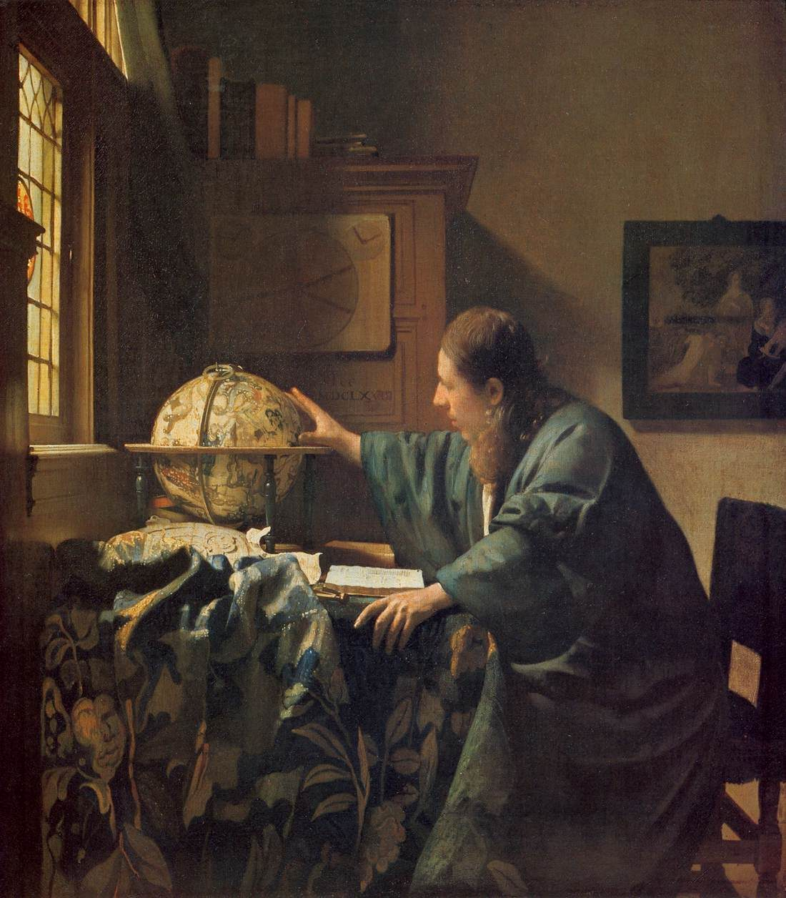
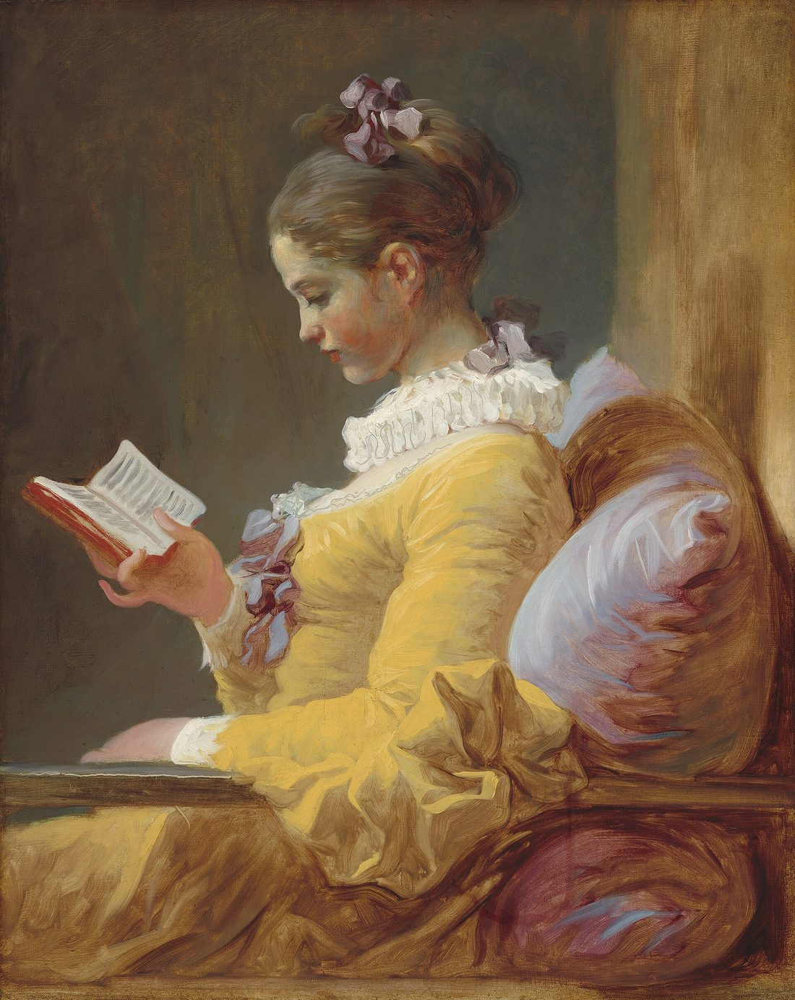
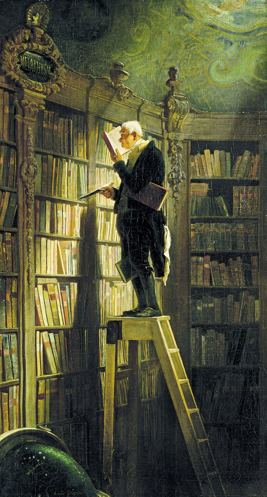
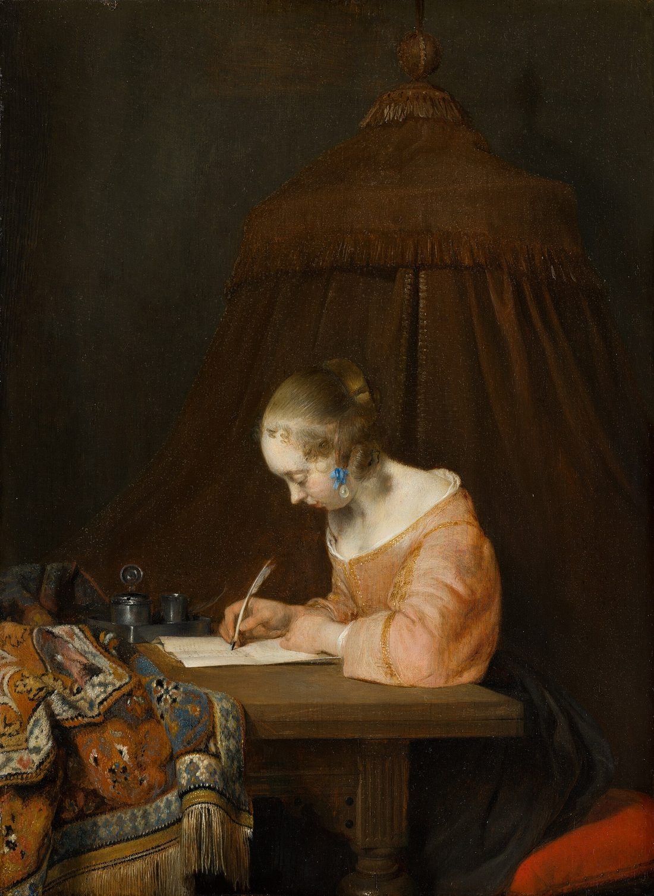
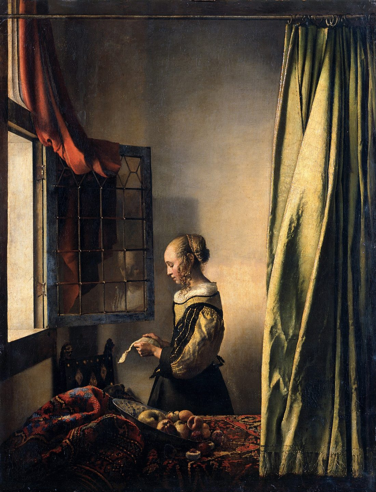
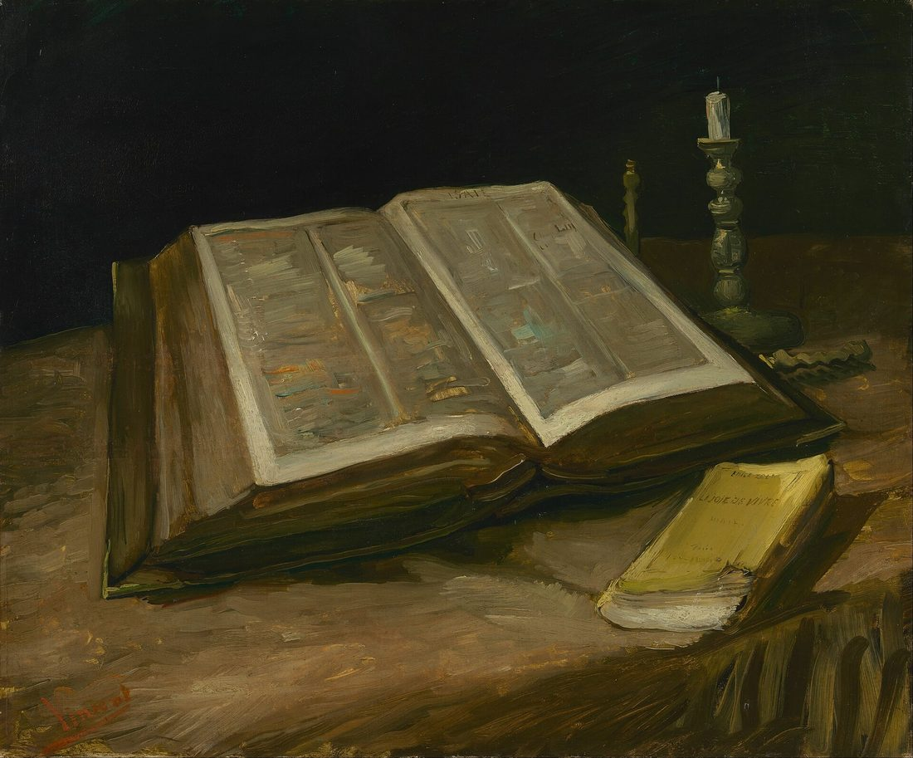
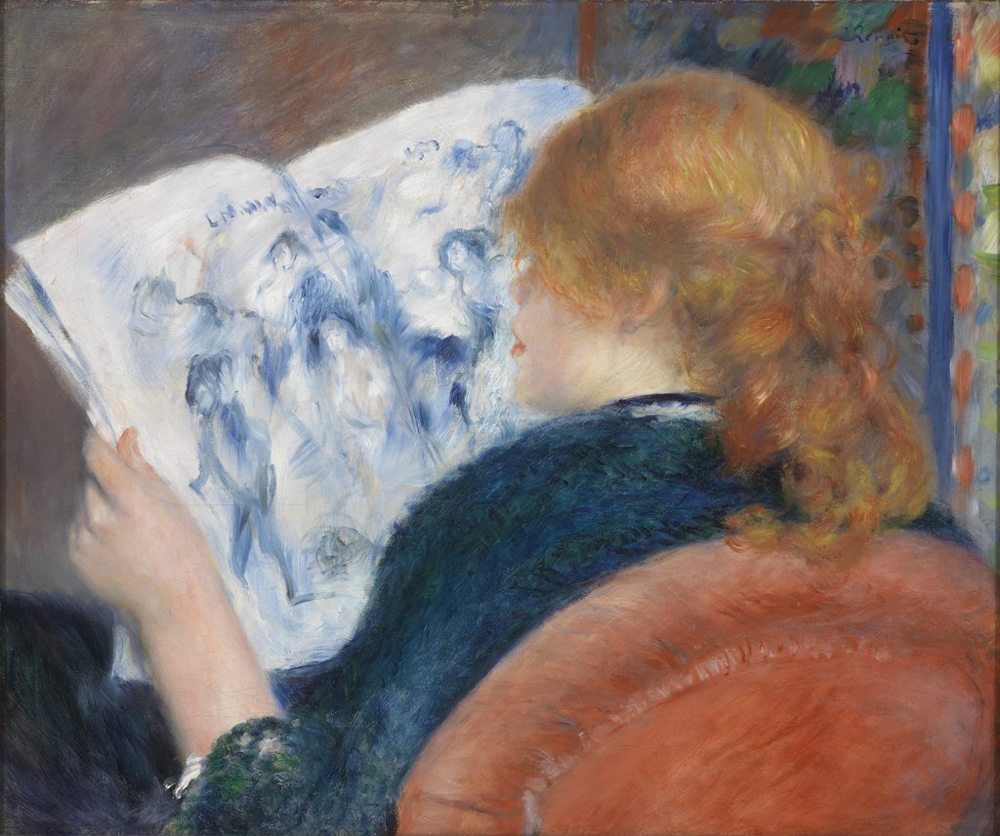

# AI시대 독서와 글쓰기의 중요성

> 답을 주는 기계 앞에서, 질문하는 사람으로 살기

윤해담 지음 · 2026

---

## 들어가며: 답은 넘치는데 질문은 줄었다

*요하네스 페르메이르, 「천문학자」(1668). 답을 찾는 사람보다 먼저, 질문을 품은 사람이 있었다.*

도서관에서 15년을 일하는 동안 가장 많이 들은 말은 "이 책 어디 있어요?"였다. 그런데 몇 해 전부터 그 질문이 눈에 띄게 줄었다. 사람들은 이제 서가 사이를 헤매지 않는다. 휴대폰을 꺼내 AI에게 묻고, 몇 초 만에 깔끔하게 정리된 답을 받는다.

나는 그 변화가 나쁘다고 생각하지 않는다. 오히려 고맙다. 정보를 찾느라 쓰던 시간을 아껴 준다는 건 분명한 축복이다. 다만 한 가지가 마음에 걸렸다. **답을 얻는 속도가 빨라질수록, 질문을 고르는 시간은 짧아지고 있었다.**

AI는 무엇이든 대답한다. 하지만 무엇을 물을지는 알려 주지 않는다. 좋은 질문은 어디에서 오는가. 나는 그 답을 오래 읽고, 천천히 써 온 사람들에게서 찾았다. 이 짧은 책은 그 이야기다.

## 1. 읽는 사람만 질문할 수 있다

*장 오노레 프라고나르, 「책 읽는 소녀」(1770년경). 읽는 동안 우리는 다른 사람의 머릿속에 잠시 머문다.*

질문은 빈 머리에서 나오지 않는다. "왜 그럴까?"라고 묻기 위해서는 먼저 "원래는 이래야 하는데"라는 기준이 있어야 한다. 그 기준을 만들어 주는 것이 독서다.

한 권의 책을 끝까지 읽는다는 건, 한 사람이 오랫동안 고민한 생각의 길을 처음부터 끝까지 따라 걷는 일이다. 그 길에는 지름길이 없다. 저자가 왜 이 장면에서 멈췄는지, 왜 저 단어를 골랐는지 따라가다 보면 어느새 내 안에도 질문이 생긴다.

- 저자는 왜 이렇게 생각했을까?
- 나라면 다르게 생각했을까?
- 이 이야기는 지금 내 삶과 어떻게 이어질까?

AI가 건네는 요약은 길의 지도와 같다. 지도는 유용하지만, 지도만 보고 그 길을 걸었다고 말할 수는 없다. 질문은 **걸어 본 사람의 다리에서** 생긴다.

## 2. 요약은 AI가, 소화는 내가

*카를 슈피츠베크, 「책벌레」(1850년경). 책이 아무리 많아도, 결국 한 권씩 꺼내 읽는 것은 나다.*

요즘 나는 AI를 이렇게 쓴다. 새 책을 고르기 전에 AI에게 그 책의 핵심 주장과 비판을 정리해 달라고 한다. 읽을 가치가 있는지 가늠하는 데 이보다 좋은 도구는 없다.

하지만 읽기로 마음먹은 책은 반드시 내 눈으로 읽는다. 요약과 독서는 전혀 다른 일이기 때문이다.

| | AI의 요약 | 나의 독서 |
|---|---|---|
| 걸리는 시간 | 몇 초 | 며칠에서 몇 주 |
| 남는 것 | 핵심 문장 몇 줄 | 나만의 밑줄과 질문 |
| 바뀌는 것 | 아는 것 | 생각하는 방식 |

음식으로 치면 요약은 영양 성분표다. 성분표를 외운다고 배가 부르지는 않는다. 꼭꼭 씹고 삼키고 소화하는 일, 그래서 그 영양이 내 몸의 일부가 되는 일은 여전히 내 몫이다.

## 3. 쓰기는 생각을 확인하는 일

*헤라르트 테르보르흐, 「편지를 쓰는 여인」(1655년경). 펜 끝에서 비로소 생각이 모양을 갖춘다.*

"머릿속으로는 다 아는데, 막상 쓰려니 안 써져요."

글쓰기 모임에서 가장 자주 듣는 고백이다. 나는 그럴 때마다 이렇게 답한다. 안 써진다면, 아직 다 아는 게 아니라고.

생각은 머릿속에 있을 때 언제나 그럴듯하다. 흐릿하고 넉넉해서 어떤 모순도 품을 수 있다. 하지만 문장으로 옮기는 순간 생각은 정직해진다. 주어와 서술어가 맞아야 하고, 앞 문장과 뒤 문장이 이어져야 한다. 쓰다가 막히는 바로 그 지점이 **내가 아직 모르는 곳**이다.

그래서 글쓰기는 생각을 전달하는 일이기 전에, 생각을 확인하는 일이다. AI가 대신 써 준 글은 매끄러울 수 있다. 하지만 그 글을 쓰는 동안 확인된 생각은 AI의 것이지 내 것이 아니다.

## 4. AI와 함께 쓰되, 내 목소리로

*요하네스 페르메이르, 「열린 창가에서 편지를 읽는 여인」(1657~1659년경). 좋은 글은 누가 썼는지 목소리가 들린다.*

그렇다고 AI를 멀리하자는 말은 아니다. 나도 매일 AI와 함께 쓴다. 다만 역할을 분명히 나눈다.

**AI에게 맡기는 일**

1. 초고를 읽고 논리가 비약하는 곳 찾아 주기
2. 같은 단어가 너무 자주 반복되는 곳 알려 주기
3. 내 주장에 대한 가장 강한 반론 들려주기

**내가 끝까지 붙드는 일**

1. 무엇에 대해 쓸지 정하기
2. 첫 문장과 마지막 문장 쓰기
3. 내 경험과 감정을 문장으로 옮기기

AI는 훌륭한 편집자이자 끈질긴 토론 상대다. 하지만 작가는 아니다. 독자가 내 글에서 듣고 싶은 것은 매끈한 문장이 아니라 **나의 목소리**다. 서툴러도 내 목소리로 쓴 문장이, 완벽하지만 누구의 것인지 모를 문장보다 오래 남는다.

## 5. 매일 한 쪽 읽고, 한 문단 쓰기

*빈센트 반 고흐, 「성경이 있는 정물」(1885). 책상 위에 늘 펼쳐 둔 한 권이 삶의 리듬을 만든다.*

거창한 결심은 오래가지 않는다. 내가 15년째 지키고 있는 습관은 아주 작다.

- [ ] 아침에 **한 쪽**만 읽는다. 더 읽고 싶으면 읽어도 되지만, 한 쪽이면 충분하다.
- [ ] 읽은 쪽에서 마음에 걸린 문장 하나를 옮겨 적는다.
- [ ] 그 문장 아래에 **한 문단**, 내 생각을 쓴다.
- [ ] 주말에는 일주일 치 문단을 다시 읽고, 마음에 드는 하나를 골라 다듬는다.

이렇게 일 년이면 365개의 문단이 쌓인다. 그중 몇 개는 칼럼이 되고, 몇 개는 강연이 되고, 어떤 것들은 모여서 이렇게 책이 된다.

AI 시대에 이 습관은 오히려 더 쉬워졌다. 옮겨 적은 문장들을 AI에게 보여 주고 "내가 요즘 어떤 주제에 끌리고 있는지 알려 줘"라고 물으면, 나도 몰랐던 내 관심사를 짚어 준다. 기록이 쌓일수록 AI는 더 좋은 대화 상대가 된다.

## 나가며: 질문하는 사람으로 남기

*피에르 오귀스트 르누아르, 「삽화 잡지를 읽는 젊은 여인」(1880). 무엇을 읽든, 읽는 사람의 얼굴은 언제나 빛난다.*

> 기계가 답을 잘할수록, 사람은 질문을 잘해야 한다.

이 책을 쓰는 동안 이 문장을 책상 앞에 붙여 두었다. 읽기는 질문을 품게 하고, 쓰기는 그 질문을 또렷하게 만든다. AI가 아무리 똑똑해져도 이 두 가지는 대신해 줄 수 없다. 대신해 줄 수 없는 일이기 때문에, 이제 더 소중해졌다.

오늘 한 쪽을 읽고, 한 문단을 써 보자. 그것이 AI 시대를 사는 가장 사람다운 방법이라고, 나는 믿는다.

---

*이 책은 강의 예시를 위해 만든 가상의 책이며, 윤해담은 가상의 인물입니다.*
